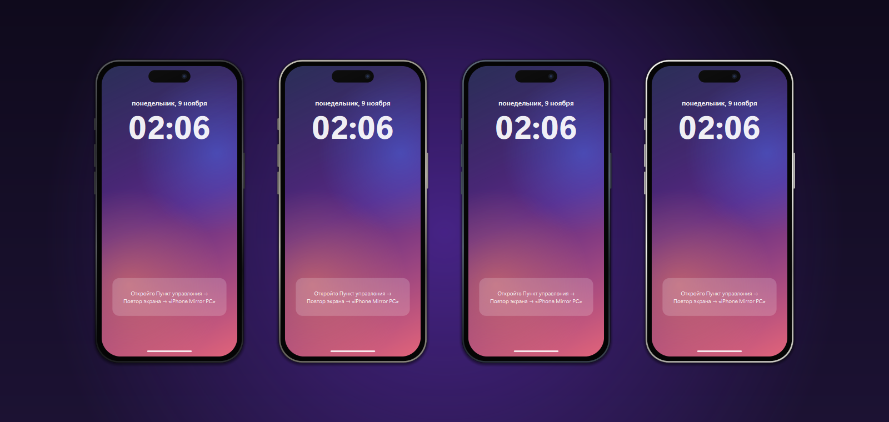
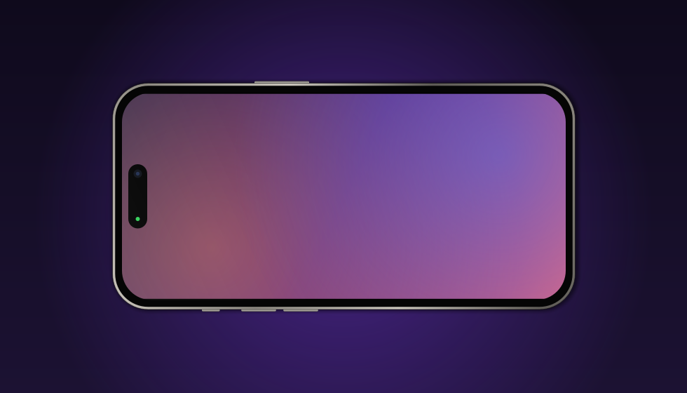
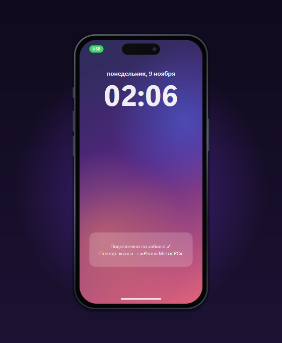
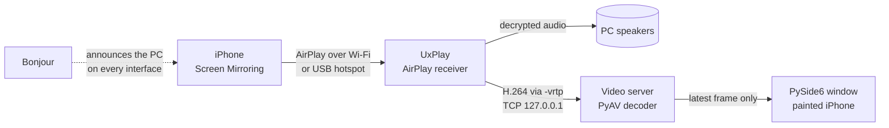

<div align="center">

<picture>
  <source media="(prefers-color-scheme: dark)" srcset="assets/logo-dark.png">
  
</picture>

# iPhone Mirror

**Your iPhone's screen and sound on a Windows PC — in a window that looks like an iPhone.**
**Over Wi‑Fi or a cable. Free, open source, no watermarks, no accounts.**

[](https://github.com/sorokin2486/iphone-mirror/releases/latest)

[](LICENSE)

**English** · [Русский](README.ru.md)



### [⬇ Download the installer](https://github.com/sorokin2486/iphone-mirror/releases/latest)

</div>

---

## Why it's cool

- **Zero setup.** One ~95 MB installer. No Python, no codec packs, no drivers, no sign-ups.
  Open Control Center → Screen Mirroring → **iPhone Mirror PC**. Done.
- **Picture *and* sound.** Video is shown in the window; audio plays through your PC speakers.
- **Works over a cable.** No Wi‑Fi, a guest network or a picky router? Plug the iPhone in over USB
  and turn on Personal Hotspot. The app detects the cable link by itself.
- **Works with a VPN on.** Most AirPlay receivers go silent when a TUN‑mode VPN (sing-box, Hiddify, …)
  is running. iPhone Mirror announces itself through Bonjour on every network interface, so the
  iPhone still finds your PC.
- **Looks like an iPhone, not like a tool.** A titanium frame in 4 colors, Dynamic Island with a live
  "streaming" dot, side buttons, an iOS‑style lock screen while it waits. It rotates to landscape
  together with your phone.
- **Resizable the natural way.** Drag any edge or corner of the phone, or press Ctrl + / − / 0,
  or pick 50–150% / "fit screen height". It never grows larger than your screen.
- **Or a plain window, ApowerMirror‑style.** Prefer no phone frame? Switch to a regular Windows window
  with a toolbar: rotate left/right, mirror, fit / stretch / fill, fullscreen (F11), always on top,
  screenshot, and "fit window to picture". The window follows the picture when you turn the iPhone.
- **Respectful to your system.** One instance only. The receiver process is tied to the app and can't
  be left running in the background. The firewall rule only allows devices **from your local network**.
- **Free and open source (GPL‑3.0).** No watermark, no time limit, no ads, no telemetry.

<table>
<tr>
<td width="60%"></td>
<td width="40%"></td>
</tr>
<tr>
<td align="center"><sub>Rotates together with the iPhone</sub></td>
<td align="center"><sub>The green <b>USB</b> badge appears when the cable link is up</sub></td>
</tr>
</table>

<p align="center"><br>
<sub>Plain window mode: toolbar on the right — fullscreen, on top, rotate, mirror, fit/stretch/fill, screenshot</sub></p>

## Quick start

1. Download and run **`iPhoneMirror-Setup-<version>.exe`** from
   [Releases](https://github.com/sorokin2486/iphone-mirror/releases/latest).
   Leave **"Allow iPhone Mirror through Windows Firewall"** checked.
2. On the iPhone: **Control Center → Screen Mirroring → iPhone Mirror PC**.

Requirements: Windows 10/11 x64, an iPhone or iPad with iOS 12+, on the same network as the PC (or over a cable, see below).

### Over a cable (USB)

1. iPhone: **Settings → Personal Hotspot → Allow Others to Join** — on.
2. Connect the cable and tap **Trust** on the iPhone.
3. A green **USB** badge appears in the window → Screen Mirroring → **iPhone Mirror PC**.

You need Apple's USB driver (the **Apple Devices** app from Microsoft Store, or iTunes). Video goes
over the cable and uses no mobile data. If Windows starts using the iPhone for internet access, turn
off **Cellular Data** on the iPhone — mirroring keeps working.

### Controls

| Action | How |
|---|---|
| Switch view | right‑click → Window view: iPhone frame / plain window (or the phone button on the toolbar) |
| Move the window | drag the phone |
| Resize | drag an edge/corner · Ctrl + mouse wheel · Ctrl + / Ctrl − / Ctrl 0 · right‑click → Scale |
| Plain window tools | Ctrl+R / Ctrl+Shift+R rotate · Ctrl+M mirror · F11 or double‑click fullscreen · Esc exit |
| Menu | right‑click: always on top, frame color, sound on/off, receiver name, USB help, log, about |
| Screenshot of the iPhone screen | Ctrl + S (saved to `Pictures\iPhone Mirror`) |
| Minimize / quit | double‑click / Ctrl + Q |

## How it's built



The hard part — the AirPlay handshake and stream decryption — is done by the open‑source
[UxPlay](https://github.com/FDH2/UxPlay). Everything around it was engineered for this app:

- **Video tap without patching UxPlay.** UxPlay's `-vrtp` option is meant to send RTP to OBS. Here it
  gets a tiny GStreamer tail (`rtph264depay ! h264parse ! tcpclientsink`) that turns the stream back into
  raw H.264 and hands it to the app over local TCP. The app decodes it with PyAV (FFmpeg).
- **No lag build‑up.** Decoding runs on its own thread and keeps only the *latest* frame. If the UI is
  briefly busy, old frames are dropped instead of queued, so the picture never falls behind the phone.
- **VPN‑proof discovery.** A TUN VPN takes over the multicast route, so mDNS announcements end up in
  the tunnel. If Bonjour is present, the app runs a second UxPlay build linked against the system
  `dnssd.dll`. Bonjour announces on all interfaces (Ethernet, Wi‑Fi, USB). Apple's SDK needs an Apple ID,
  so the build makes its own: the header from Apple's open `mDNSResponder` sources plus an import
  library generated from the DLL.
- **Cable detection.** iPhone Personal Hotspot always uses `172.20.10.0/28`. The app watches the network
  interfaces, tells a USB link (Ethernet type) from a Wi‑Fi hotspot, and restarts the receiver so the
  new link gets announced.
- **Clean process handling.** UxPlay runs inside a Windows Job Object with *kill on close*, so it can't
  outlive the app even after a crash. A local socket keeps a single instance and brings the existing
  window to the front.
- **Portable media stack.** Only the GStreamer plugins UxPlay actually uses are bundled (found with
  `ldd`), and unused Qt modules are stripped. The installer is about 95 MB.
- **The phone is drawn, not a bitmap.** The frame, island, buttons and lock screen are painted with
  QPainter, so the window stays crisp at any scale and in landscape.

## Troubleshooting

- **The iPhone doesn't see the PC.** Same network? No client isolation on the router? With a VPN on,
  make sure Bonjour is installed (it comes with Apple Devices / iTunes). The first line of
  right‑click → *UxPlay log* should read "Bonjour".
- **"Unable to connect".** The firewall is blocking it. Reinstall and keep the firewall checkbox ticked.
- **Black screen.** Right‑click → *Restart receiver*. If it persists, open an issue with the log attached.

## Build from source

```powershell
powershell -ExecutionPolicy Bypass -File setup\install.ps1          # .venv, MSYS2, GStreamer, UxPlay (+ Bonjour variant)
powershell -ExecutionPolicy Bypass -File setup\build_installer.ps1 -BuildExe   # dist\iPhoneMirror-Setup-<ver>.exe
.venv\Scripts\python -m pytest -q                                  # tests
```

<details>
<summary>Project structure</summary>

```
app/
  __main__.py         entry point, wires everything together
  receiver.py         UxPlay process: arguments, log, restart
  bonjour.py          Bonjour vs built-in mDNS
  video_stream.py     local TCP server + H.264 decoder, latest-frame buffer
  usb_link.py         cable / hotspot detection
  phone_skin.py       iPhone frame geometry and painting
  lock_screen.py      iOS-style waiting screen
  phone_view.py       phone + video widget, landscape rotation
  main_window.py      iPhone-frame window: drag, scale, menu
  plain_window.py     plain window with toolbar (rotate, mirror, fit modes, fullscreen)
  plain_view.py       video area of the plain window
  image_ops.py        rotation / mirror / fit-stretch-fill geometry
  common_actions.py   menu items shared by both views
  scaling.py          edge-drag scaling math
  single_instance.py  one instance only
  win_job.py          Job Object: UxPlay dies with the app
  about_dialog.py     About window
setup/                install, UxPlay builds, bundling, icon, screenshots, exe and installer builds
installer/            Inno Setup script
tests/                pytest
```
</details>

## Author

<picture>
  <source media="(prefers-color-scheme: dark)" srcset="assets/logo-dark.png">
  
</picture>

**Ivan Sorokin (Сорокин Иван)** — *sorokin dev* · [github.com/sorokin2486](https://github.com/sorokin2486)

## License

© 2026 Ivan Sorokin (sorokin dev). Released under [GPL‑3.0‑or‑later](LICENSE). The project includes UxPlay (GPL‑3.0).
Third‑party components are listed in [THIRD_PARTY_NOTICES.md](THIRD_PARTY_NOTICES.md).
The "sorokin dev" logo is not covered by the GPL.
AirPlay and iPhone are trademarks of Apple Inc. This project is not affiliated with Apple.
