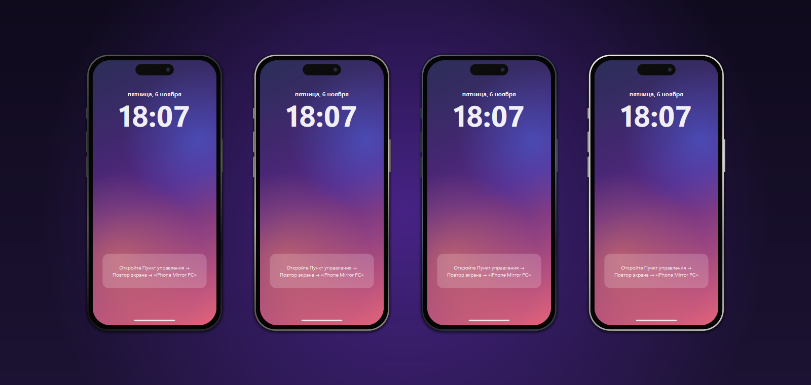
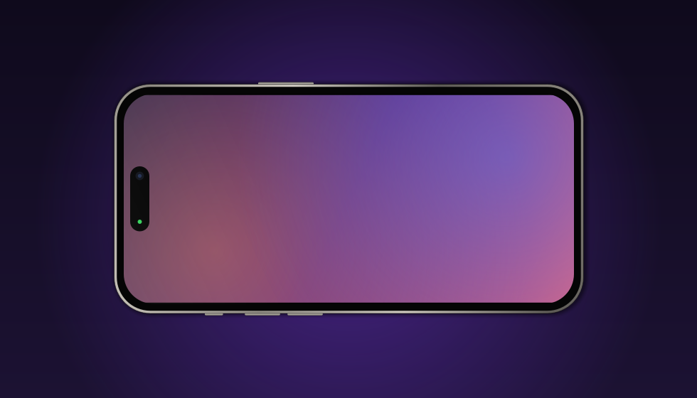
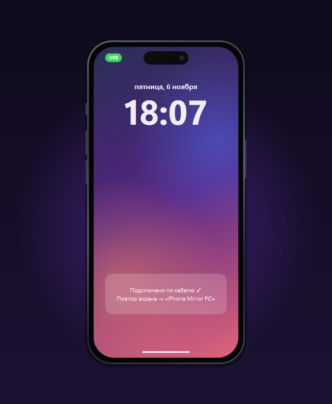
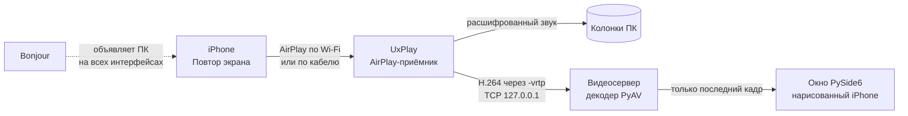

<div align="center">

<picture>
  <source media="(prefers-color-scheme: dark)" srcset="assets/logo-dark.png">
  
</picture>

# iPhone Mirror

**Экран и звук iPhone на Windows — в окне, которое выглядит как iPhone.**
**По Wi‑Fi или по кабелю. Бесплатно, с открытым кодом, без водяных знаков и регистрации.**

[](https://github.com/sorokin2486/iphone-mirror/releases/latest)

[](LICENSE)

[English](README.md) · **Русский**



### [⬇ Скачать установщик](https://github.com/sorokin2486/iphone-mirror/releases/latest)

</div>

---

## Почему это круто

- **Ноль настройки.** Один установщик примерно на 95 МБ. Не нужны ни Python, ни кодеки, ни драйверы,
  ни регистрация. Пункт управления → Повтор экрана → **iPhone Mirror PC**, и всё.
- **Картинка *и* звук.** Видео показывается в окне, звук идёт в колонки ПК.
- **Работает по кабелю.** Нет Wi‑Fi, гостевая сеть или капризный роутер? Подключите iPhone кабелем
  и включите «Режим модема». Приложение само заметит подключение.
- **Работает с включённым VPN.** Большинство AirPlay‑приёмников перестают находиться, когда работает
  VPN в режиме TUN (sing-box, Hiddify и т.п.). iPhone Mirror объявляет себя через Bonjour на всех
  сетевых интерфейсах, и айфон всё равно видит ПК.
- **Выглядит как iPhone, а не как утилита.** Титановая рамка четырёх цветов, Dynamic Island с зелёной
  точкой трансляции, боковые кнопки, экран блокировки в стиле iOS, пока ждёт подключения.
  Поворачивается горизонтально вместе с телефоном.
- **Масштаб меняется естественно.** Тяните за любой край или угол телефона, жмите Ctrl + / − / 0
  или выберите 50–150% или «по высоте экрана». Больше экрана окно не вырастет.
- **Бережно к системе.** Запускается только одна копия. Приёмник привязан к приложению и не останется
  висеть в фоне. Правило брандмауэра пускает только устройства **из вашей локальной сети**.
- **Бесплатно и с открытым кодом (GPL‑3.0).** Без водяных знаков, ограничений по времени, рекламы
  и телеметрии.

<table>
<tr>
<td width="60%"></td>
<td width="40%"></td>
</tr>
<tr>
<td align="center"><sub>Поворачивается вместе с iPhone</sub></td>
<td align="center"><sub>Зелёная плашка <b>USB</b> — iPhone подключён кабелем</sub></td>
</tr>
</table>

## Быстрый старт

1. Скачайте и запустите **`iPhoneMirror-Setup-<версия>.exe`** со страницы
   [Releases](https://github.com/sorokin2486/iphone-mirror/releases/latest).
   Оставьте отмеченным **«Разрешить iPhone Mirror в брандмауэре Windows»**.
2. На iPhone: **Пункт управления → Повтор экрана → iPhone Mirror PC**.

Требования: Windows 10/11 x64, iPhone или iPad с iOS 12+ в одной сети с ПК (или по кабелю, см. ниже).

### По кабелю (USB)

1. iPhone: **Настройки → Режим модема → «Разрешать другим»** — включить.
2. Подключите кабель и нажмите на iPhone **«Доверять»**.
3. В окне появится зелёная плашка **USB** → Повтор экрана → **iPhone Mirror PC**.

Нужен USB‑драйвер Apple: приложение **«Устройства Apple»** из Microsoft Store или iTunes.
Видео идёт по кабелю и не тратит мобильный трафик. Если Windows начнёт ходить в интернет
через iPhone, выключите на iPhone **«Сотовые данные»** — трансляция продолжит работать.

### Управление

| Действие | Как |
|---|---|
| Двигать окно | зажать телефон мышью |
| Масштаб | тянуть за край или угол · Ctrl + колесо · Ctrl + / Ctrl − / Ctrl 0 · ПКМ → Масштаб |
| Меню | ПКМ: поверх всех окон, цвет, звук, имя приёмника, помощь по USB, журнал, о программе |
| Скриншот экрана iPhone | Ctrl + S (в `Изображения\iPhone Mirror`) |
| Свернуть / выйти | двойной клик / Ctrl + Q |

## Как это устроено



Самое сложное — рукопожатие AirPlay и расшифровку потока — делает открытый
[UxPlay](https://github.com/FDH2/UxPlay). Всё вокруг него сделано специально для этого приложения:

- **Перехват видео без правки UxPlay.** Опция `-vrtp` в UxPlay задумана для отправки RTP в OBS. Здесь ей
  передаётся маленький хвост пайплайна GStreamer (`rtph264depay ! h264parse ! tcpclientsink`), который
  превращает поток обратно в сырой H.264 и отдаёт приложению по локальному TCP. Приложение
  декодирует его через PyAV (FFmpeg).
- **Задержка не копится.** Декодирование идёт в отдельном потоке и хранит только *последний* кадр. Если
  интерфейс на мгновение занят, старые кадры выбрасываются, а не встают в очередь. Картинка не отстаёт
  от телефона.
- **Поиск ПК, который не ломается от VPN.** VPN в режиме TUN забирает маршрут multicast, и объявления
  mDNS уходят в туннель. Если на ПК есть Bonjour, приложение запускает второй вариант UxPlay,
  собранный с системной `dnssd.dll`. Bonjour объявляет ПК на всех интерфейсах (Ethernet, Wi‑Fi, USB).
  Официальный SDK от Apple требует Apple ID, поэтому сборка делает свой: заголовок из открытых
  исходников Apple `mDNSResponder` плюс библиотека импорта, сгенерированная из самой DLL.
- **Определение кабеля.** «Режим модема» iPhone всегда раздаёт подсеть `172.20.10.0/28`. Приложение следит
  за сетевыми интерфейсами, отличает USB (тип Ethernet) от точки доступа по Wi‑Fi и перезапускает
  приёмник, чтобы объявить его в новой сети.
- **Аккуратная работа с процессами.** UxPlay работает внутри Windows Job Object с *kill on close* и не
  переживёт приложение даже при падении. Локальный сокет не даёт запустить вторую копию и показывает
  уже открытое окно.
- **Переносимый медиастек.** В сборку попадают только те плагины GStreamer, которые реально использует
  UxPlay (найдены через `ldd`), а лишние модули Qt вырезаются. Установщик весит около 95 МБ.
- **Телефон нарисован, а не вставлен картинкой.** Рамка, остров, кнопки и экран блокировки рисуются
  QPainter, поэтому окно чёткое при любом масштабе и в горизонтальном режиме.

## Если не работает

- **iPhone не видит ПК.** Одна сеть? Нет ли на роутере изоляции клиентов? При включённом VPN нужен
  Bonjour (ставится с «Устройствами Apple» или iTunes). В ПКМ → *Журнал UxPlay* первой строкой должно
  быть «Bonjour».
- **«Не удаётся подключиться».** Мешает брандмауэр. Переустановите и оставьте галочку брандмауэра.
- **Чёрный экран.** ПКМ → *Перезапустить приёмник*. Не помогло — создайте issue и приложите журнал.

## Сборка из исходников

```powershell
powershell -ExecutionPolicy Bypass -File setup\install.ps1          # .venv, MSYS2, GStreamer, UxPlay (+ вариант с Bonjour)
powershell -ExecutionPolicy Bypass -File setup\build_installer.ps1 -BuildExe   # dist\iPhoneMirror-Setup-<версия>.exe
.venv\Scripts\python -m pytest -q                                  # тесты
```

<details>
<summary>Структура проекта</summary>

```
app/
  __main__.py         точка входа, связывает всё вместе
  receiver.py         процесс UxPlay: аргументы, журнал, перезапуск
  bonjour.py          Bonjour или встроенный mDNS
  video_stream.py     локальный TCP‑сервер + декодер H.264, буфер последнего кадра
  usb_link.py         определение кабеля / точки доступа
  phone_skin.py       геометрия и отрисовка корпуса iPhone
  lock_screen.py      экран ожидания в стиле iOS
  phone_view.py       виджет: телефон + видео, поворот
  main_window.py      безрамочное окно, меню, скриншоты
  scaling.py          расчёт масштаба при перетаскивании краёв
  single_instance.py  только одна копия приложения
  win_job.py          Job Object: UxPlay завершается вместе с приложением
  about_dialog.py     окно «О программе»
setup/                установка, сборки UxPlay, упаковка, иконка, скриншоты, сборка exe и установщика
installer/            скрипт Inno Setup
tests/                pytest
```
</details>

## Автор

<picture>
  <source media="(prefers-color-scheme: dark)" srcset="assets/logo-dark.png">
  
</picture>

**Сорокин Иван** — *sorokin dev* · [github.com/sorokin2486](https://github.com/sorokin2486)

## Лицензия

© 2026 Сорокин Иван (sorokin dev). Распространяется под [GPL‑3.0‑or‑later](LICENSE), так как включает UxPlay (GPL‑3.0).
Сторонние компоненты перечислены в [THIRD_PARTY_NOTICES.md](THIRD_PARTY_NOTICES.md).
Логотип «sorokin dev» не распространяется под GPL.
AirPlay и iPhone — торговые марки Apple Inc. Проект не связан с Apple.
